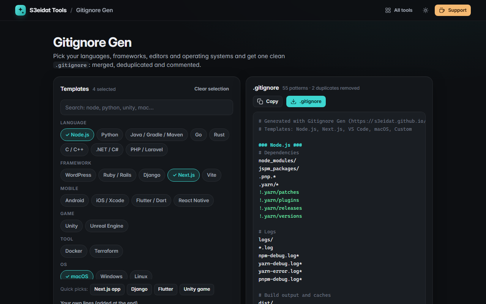

# Gitignore Gen

> Build a `.gitignore` for any stack: pick templates, get one merged, deduplicated file. Free, private, and it runs entirely in your browser.

### ▶ [Open Gitignore Gen](https://s3eidat.github.io/gitignore-gen/)



## Features

- 28 hand-written templates:
  - **Languages**: Node.js, Python, Java / Gradle / Maven, Go, Rust, C / C++, .NET / C#, PHP / Laravel
  - **Frameworks**: WordPress, Ruby / Rails, Django, Next.js, Vite
  - **Mobile**: Android, iOS / Xcode, Flutter / Dart, React Native
  - **Game engines**: Unity, Unreal Engine
  - **Tools**: Docker, Terraform
  - **Operating systems**: macOS, Windows, Linux
  - **Editors**: VS Code, JetBrains, Vim
- **Search** (also by keyword: "pycharm", "cargo", "expo"…) and multi-select; press Enter to pick the first match
- Quick picks for common stacks
- **Merged and deduplicated**: a pattern that appears in two templates is written once; negations (`!.env.example`) are kept in order
- Optional **section headers**, plus **your own lines** at the end
- Copy or **download `.gitignore`**; your selection is remembered on this device

## Privacy

Everything happens on your device. There is no server, no account, no analytics.
The page ships with a strict Content-Security-Policy (`connect-src 'self'`), so the browser
itself blocks any attempt to send data anywhere.

## Run it yourself

It's plain HTML, CSS and JavaScript with no build step:

```bash
git clone https://github.com/s3eidat/gitignore-gen
cd gitignore-gen
python -m http.server 8000
```

Then open http://localhost:8000.

## Support

If this saved you time, **[buy me a coffee ☕](https://s3eidat.github.io/coffee/)**. It keeps every tool free.

---

Part of **[S3eidat Tools](https://s3eidat.github.io/)**: 100+ free, private tools that run in your browser. MIT licensed.
